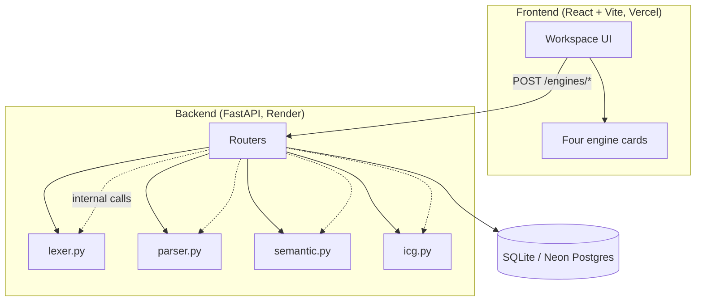
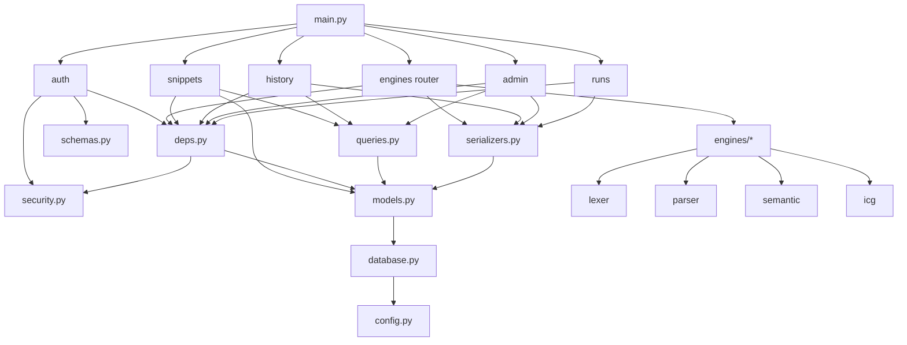
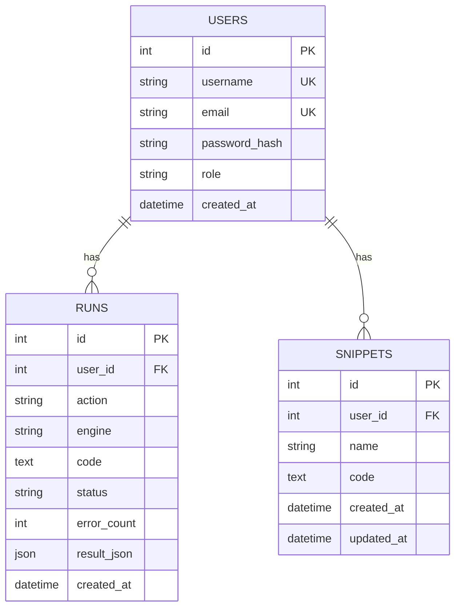
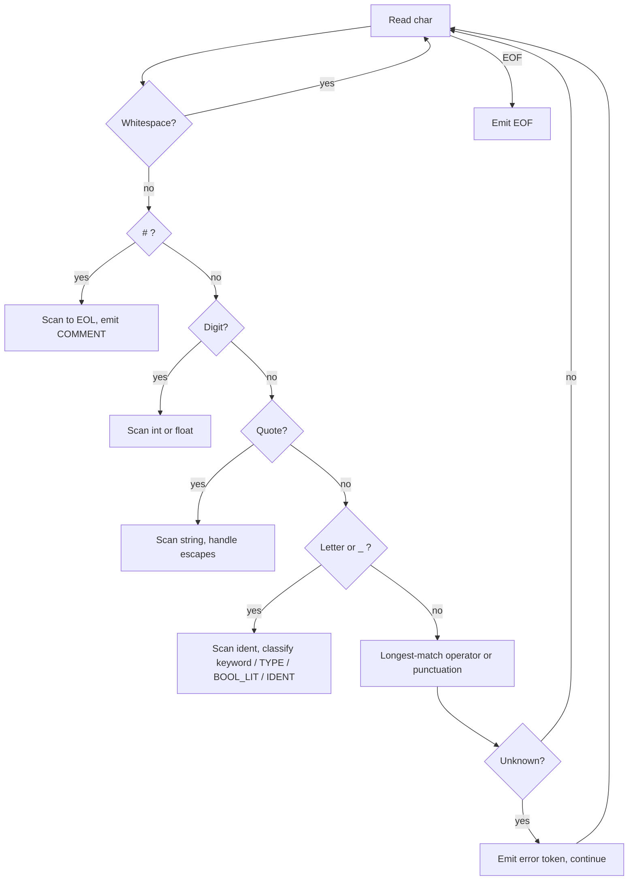
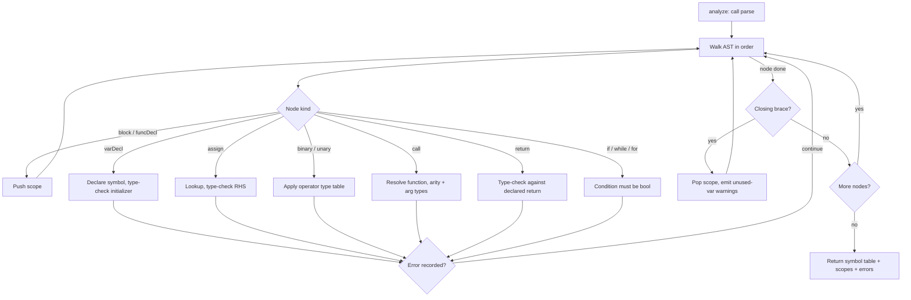
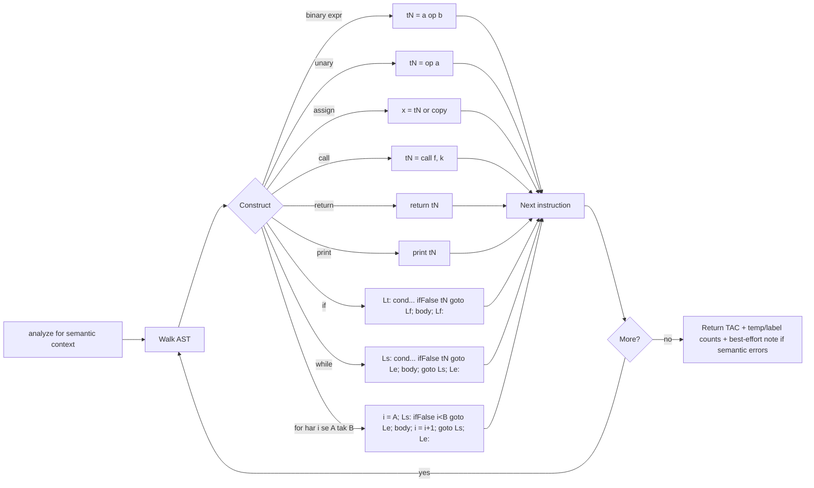
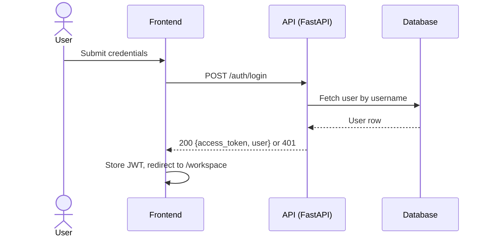
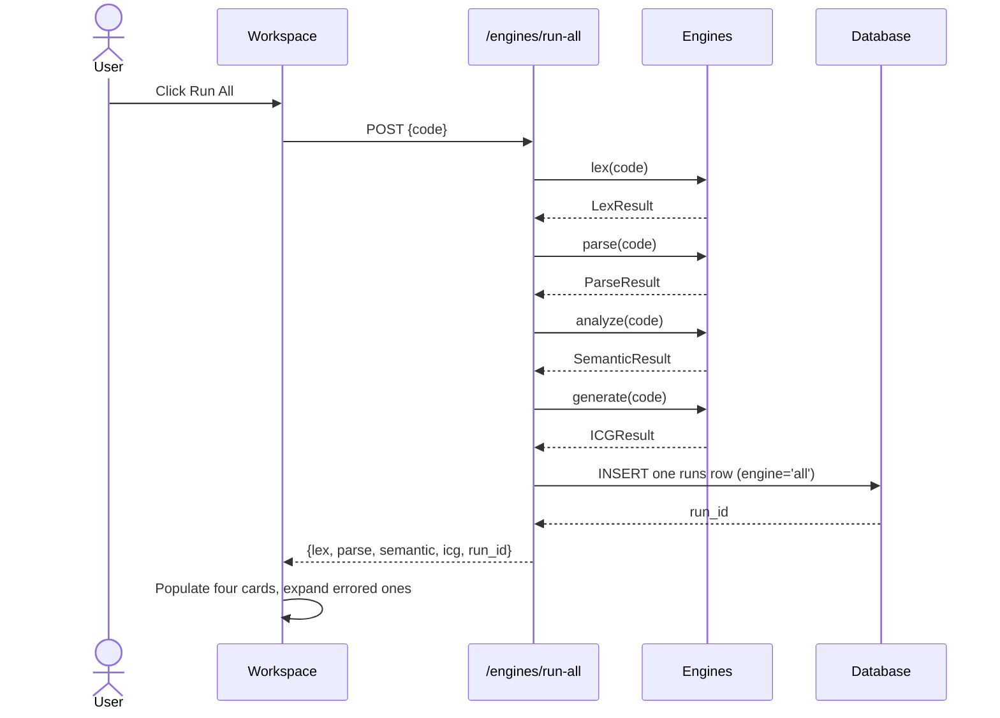
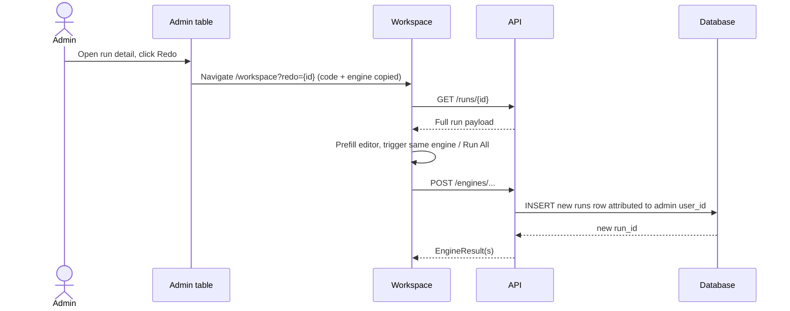
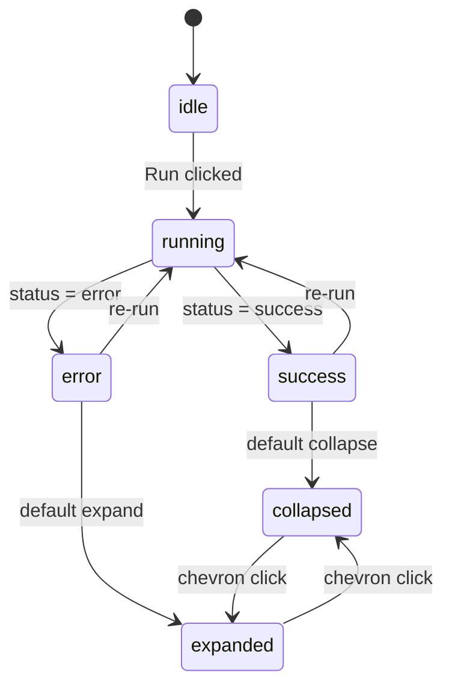

# Compiler Lab — Project Report

> **Status:** Skeleton. Sections are filled phase-by-phase as the corresponding build phase completes. Every Mermaid block is pre-placed and currently contains a placeholder node — replaced with the real diagram when its phase is verified. Screenshot embeds land with the screenshot phase.

---

## 1. Cover page

| Field | Value |
|---|---|
| Project title | Compiler Lab |
| Language | ZubaanScript |
| Course | Compiler Construction |
| Repository | https://github.com/KHassanTaha/compiler-lab |
| Report version | 0.1 (skeleton) |

---

## 2. Abstract

*To be written after the implementation is complete (target: 150–200 words covering the four-stage frontend, the web playground motivation, engine independence, and test coverage results).*

---

## 3. Introduction

*To be written: motivation (learning compilers by seeing each stage in isolation), the ZubaanScript language choice (Hinglish keywords, explicit types), product overview (auth, history, admin, shareable runs). The user-journey diagram (§3.1) is written with the frontend phases.*

### 3.1 User journey

```mermaid
journey
    title User journey (placeholder — filled in phase 12)
    Section Placeholder:
      Awaiting implementation: 5: Developer
```

---

## 4. System Requirements

### 4.1 Functional requirements

*Table derived from the product requirements: four engines, auth, history, admin, snippets, sharing, examples, grammar reference, screenshots.*

### 4.2 Non-functional requirements

*Coverage gate ≥ 85%, response-time targets, free-tier deployment, accessibility, responsive layout.*

---

## 5. Language Specification

### 5.1 Keywords

*Hinglish ↔ English mapping table (source: in-app /docs, generated from the keyword module).*

### 5.2 EBNF

```ebnf
(* filled from the specification — full grammar listing *)
program ::= statement* EOF
```

### 5.3 Type rules

*Operator operand/result table including integer division truncation, `%` int-only, string `+` concatenation, comparison and logical rules — as locked in the specification pins.*

---

## 6. System Architecture



*6.1 narrative: request flow for engine runs; engine independence; logging contract (one action → one row).*

*6.2 Module dependency graph (backend package layout).*



The engine modules (`engines/*`) import nothing from `routers/`, `models.py`, or FastAPI/SQLAlchemy — the purity rule in AGENTS §3.4. The dependency direction is one-way: `routers → {queries, serializers, deps, engines} → models → database → config`. Phases 5–6 are complete and committed.

---

## 7. Database Design



*7.1 narrative: indexes, the unified `runs` log model, why durations live in `result_json` and not a column.*

---

## 8. Engine Design & Algorithms

### 8.1 Lexer



*8.1 narrative: longest-match operators, line/column tracking, error-and-continue policy.*

### 8.2 Parser

```mermaid
flowchart TD
    Entry[parse: call lex] --> Stmt{Statement dispatch}
    Stmt --> Var[varDecl]
    Stmt --> Asgn[assignStmt]
    Stmt --> If[ifStmt]
    Stmt --> While[whileStmt]
    Stmt --> For[forStmt]
    Stmt --> Func[funcDecl]
    Stmt --> Ret[returnStmt]
    Stmt --> Prt[printStmt]
    Stmt --> Other[exprStmt / block]
    Var --> Err{Error?}
    Asgn --> Err
    If --> Err
    While --> Err
    For --> Err
    Func --> Err
    Ret --> Err
    Prt --> Err
    Other --> Err
    Err -->|no| Next[Advance to next statement]
    Err -->|yes| Recover[Record error, panic recovery]
    Recover --> Sync[Skip until ; } or EOF]
    Sync --> Guard{Progress made?}
    Guard -->|yes| Next
    Guard -->|no| Abort[Abort to avoid infinite loop]
    Next --> More{More statements?}
    More -->|yes| Stmt
    More -->|no| Done[Return tree + derivation + errors]
    Abort --> Done
```

*8.2 narrative: precedence chain, sync tokens, progress guard.*

### 8.3 Semantic analysis



*8.3 narrative: scope stack push/pop, the eight checks in evaluation order, warning vs error severity.*

### 8.4 ICG — three-address code lowering



*8.4 narrative: temporary and label allocation, for-loop lowering, best-effort mode on semantic errors.*

---

## 9. API Reference

*Condensed endpoint table (method, path, auth, purpose), request/response examples for each engine result shape and the pagination envelope. Sequence diagrams below.*

### 9.1 Login flow



### 9.2 Engine run flow



### 9.3 Admin redo flow



---

## 10. Frontend Design

### 10.1 Component tree and route map

Route table (React Router 7, `App.tsx`):

| Route | Page | Gate |
|---|---|---|
| `/` | LandingPage | public |
| `/login` | LoginPage | public |
| `/register` | RegisterPage | public |
| `/docs` | DocsPage | public (no backend dependency) |
| `/workspace` | WorkspacePage | `ProtectedRoute` |
| `/history` | HistoryPage | `ProtectedRoute` |
| `/runs/:id` | SharedRunPage | `ProtectedRoute` |
| `/admin` | AdminPage | `AdminRoute` |
| `*` | NotFoundPage | — |

Dependency direction (AGENTS §4.2): `pages → features → components + lib`. `lib/` never imports from `features/` or `pages/`; `components/ui/` never imports from `features/`. All network access funnels through `lib/api.ts`, which owns the 401/403/500 policy once. `ErrorBoundary` wraps the app; `AuthProvider` supplies session state via `AuthContext` + `useAuth`.

Workspace subtree (`features/workspace/`, D-58):

```
WorkspacePage
├── CodePanel              example/snippet pickers, Save, char/line counts, Run All
│   └── Editor             @uiw/react-codemirror + zubaanLanguage + zubaanHighlight
├── GrammarPanel           accordion from GET /grammar
├── SnippetDialog          POST /snippets (new) | PUT /snippets/{id} (update)
└── OutputPanel            run/share action bar + four EngineCards
    └── EngineCard         configured from ENGINES[] (engineConfig.tsx)
        └── renderFormatted → LexerView | ParserView | SemanticView | IcgView
                              (+ shared EngineErrors list)
```

`EngineCard` is driven by a single `ENGINES` config array (D-58): each entry pairs the engine key, its `lex`/`parse`/`semantic`/`icg` URL slug, its raw-JSON `data-testid`, and a `renderFormatted(result)` closure. The card chrome (status badge, duration, Raw/Formatted toggle, copy, collapse chevron, error list) is written once. `EngineCard` supports `readOnly` to hide the Run button (D-63).

History / Admin subtree (`features/history/`, shared, D-61):

```
HistoryPage                     own fetch state (requestKey-derived loading, D-62)
├── RunFilters                  action | engine | status | q (debounced 300 ms) | from | to | clear + extra
└── RunsTable                   sortable columns: Date, User, Action, Engine, Status, Errors, Code, Actions
                                showUser=true on Admin; onRowClick override for modal (D-64)
                                row click → /runs/:id or modal ; Redo → /workspace?redo=:id
filters.ts                      RunFilters shape, option lists, hasActiveFilters, runsQueryParams
```

`lib/runResult.ts` normalises `result_json`; `features/runs/RunResultView` renders read-only engine cards. `features/admin/` provides `StatsCards`, `UsersTable`, `UserFilterSelect`, `RunDetailModal`. `pages/AdminPage` tabs Runs/Users with stats and modal. `pages/SharedRunPage` (`/runs/:id`) shows full code and results with Redo/Back.

Both runs pages build their query string through `runsQueryParams` (pins B1–B4): empty filters are dropped so the backend sees no constraint, and `sort` is emitted as `field:asc|desc`.

### 10.2 Engine card lifecycle



### 10.3 Design tokens

Palette, typography, radius, and shadow are declared as Tailwind v4 `@theme` tokens in `frontend/src/index.css` (D-55). Colours follow PRD §11 exactly (cream/beige/peach/gold/brown + status pairs). Fonts: Fraunces (display), Montserrat (body), JetBrains Mono (code), loaded from Google Fonts in `index.html`. Motion is Framer Motion — page transition (opacity + 8px rise, 200 ms); all motion suppressed under `prefers-reduced-motion` via a global CSS media query.

### 10.4 Workspace data flow

`Run All` sends one `POST /engines/run-all`; the response's `lex`/`parse`/`semantic`/`icg` results map onto the four engine keys, and the single top-level `run_id` becomes the share link target (`/runs/{id}`). Per-engine `Run` buttons send `POST /engines/{slug}` and replace only that card. `?redo={id}` fetches `GET /history/{id}`, prefills the editor, and dispatches the same stage (or Run All when the run's engine is `all`) — the URL param is cleared in the request's `finally` block (D-59). After a run with failures, the page smooth-scrolls to the first errored card.

---

## 11. Testing

*Coverage table (per module, final %), test-file → count table, notable edge cases (panic recovery ≥ 3 errors, best-effort ICG, run-all single row). Filled after the coverage phase.*

---

## 12. Deployment

*Render + Vercel + Neon setup steps, environment variables, verified commands. Filled after deploy verification.*

---

## 13. Results & Discussion

*Final behaviour summary, coverage numbers, screenshot appendix reference, limitations (no path analysis for returns, no void type, no rate limiting).*

---

## 14. Conclusion & Future Work

*Conclusion; future work: path-sensitive return checking, void functions, grammar versioning, richer string operations, auth-event logging.*

---

## 15. References

*Course materials, FastAPI/SQLAlchemy/React documentation, classic compiler references (dragon book), ZubaanScript specification version.*

---

## 16. Appendix: Screenshots

*All 23 captures embedded with captions, in playbook order. Placeholder list:*

- `screenshots/01-landing.png` — Landing page *(pending)*
- `screenshots/02-register.png` — Registration *(pending)*
- `screenshots/03-login.png` — Login *(pending)*
- `screenshots/04-docs.png` — In-app documentation *(pending)*
- `screenshots/05-workspace-empty.png` — Empty workspace *(pending)*
- `screenshots/06-grammar-panel.png` — Grammar reference panel *(pending)*
- `screenshots/07-example-loaded.png` — Example loaded in editor *(pending)*
- `screenshots/08-run-all-success.png` — Run All success state *(pending)*
- `screenshots/09-lexer-output.png` — Lexer tokens table *(pending)*
- `screenshots/10-parser-tree.png` — Parser tree view *(pending)*
- `screenshots/11-semantic-table.png` — Symbol table view *(pending)*
- `screenshots/12-icg-tac.png` — TAC listing *(pending)*
- `screenshots/13-error-state.png` — Error state across engines *(pending)*
- `screenshots/14-raw-json-toggle.png` — Raw JSON toggle *(pending)*
- `screenshots/15-save-snippet-modal.png` — Save snippet modal *(pending)*
- `screenshots/16-history.png` — History table *(pending)*
- `screenshots/17-history-filters.png` — History filters *(pending)*
- `screenshots/18-admin-dashboard.png` — Admin dashboard *(pending)*
- `screenshots/19-admin-runs-filtered.png` — Admin runs filtered by user *(pending)*
- `screenshots/20-shared-run.png` — Shared run view *(pending)*
- `screenshots/21-404.png` — 404 page *(pending)*
- `screenshots/22-mobile-landing.png` — Mobile landing *(pending)*
- `screenshots/23-mobile-workspace.png` — Mobile workspace *(pending)*
